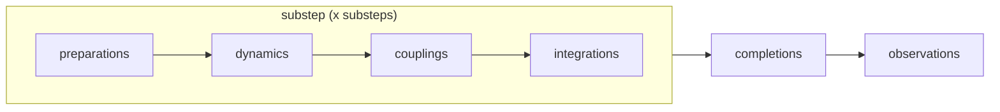
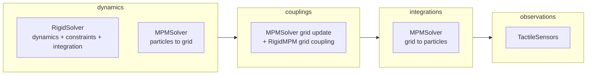
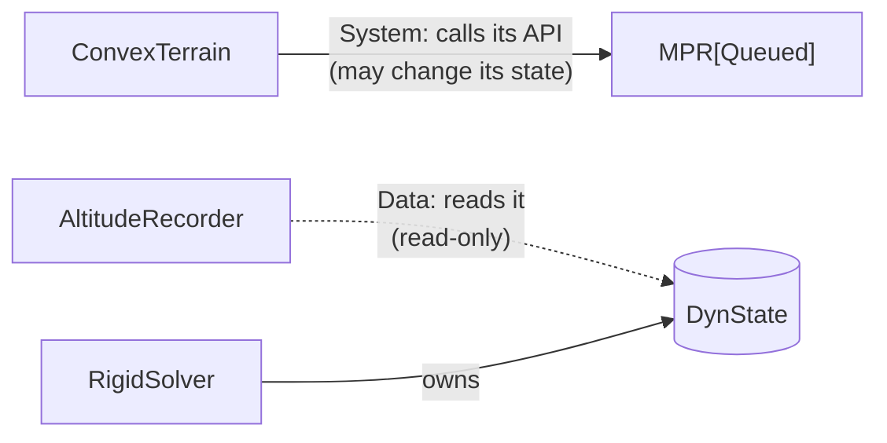
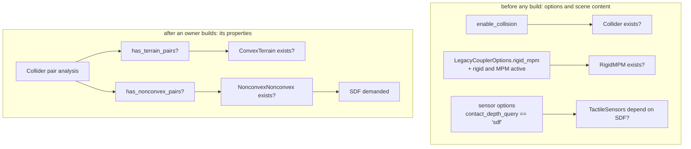
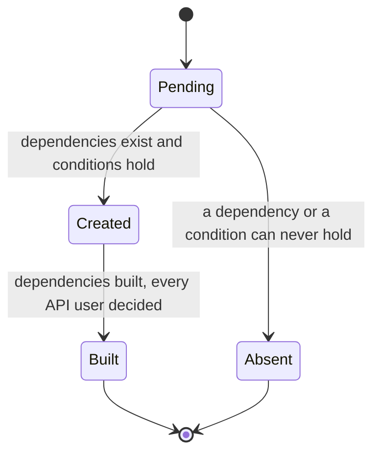
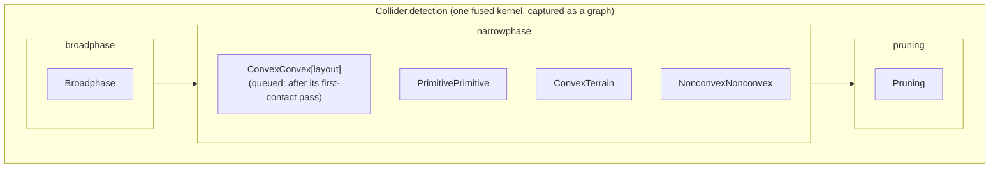
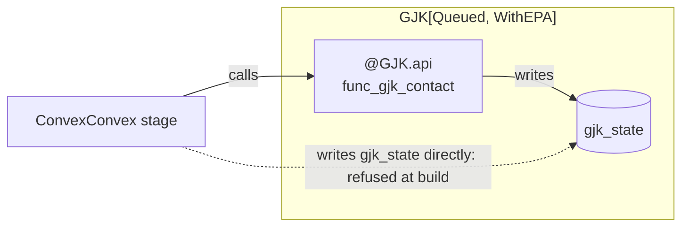
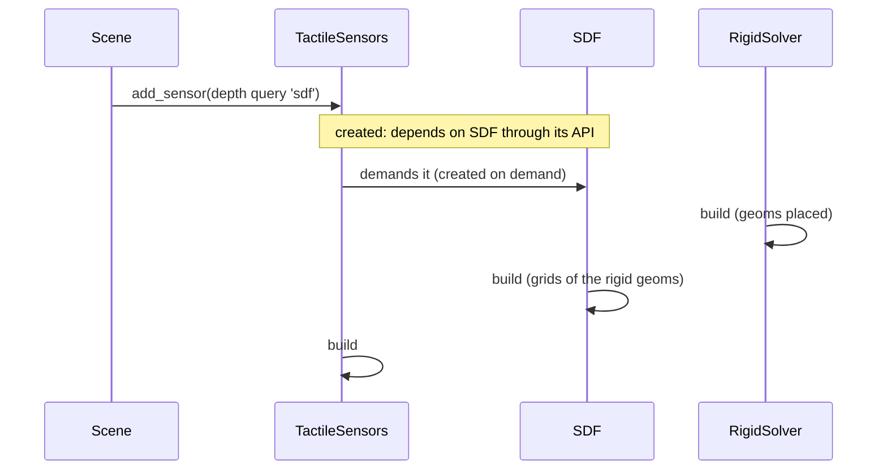
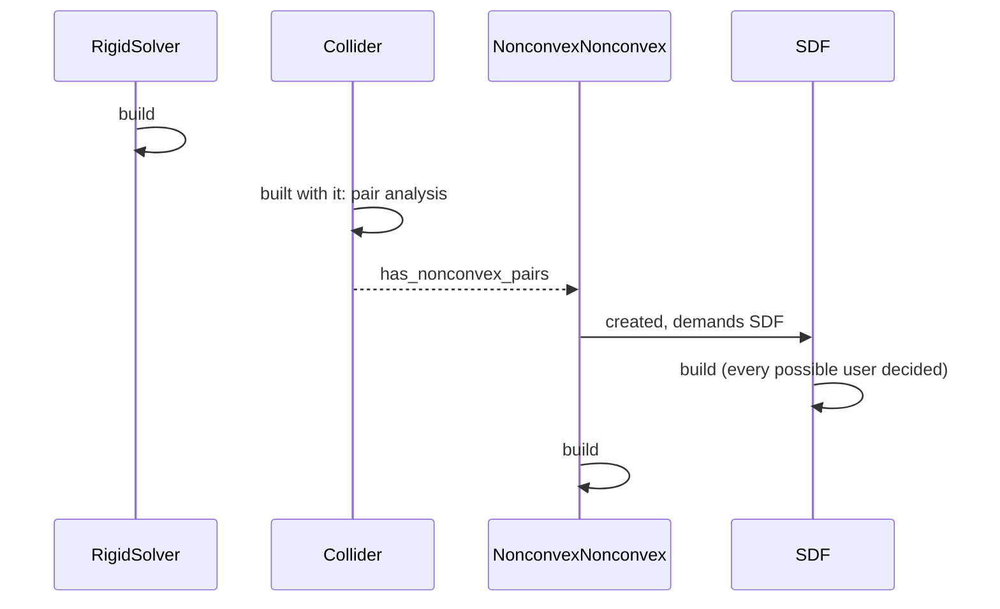

# The Composable Simulation Pipeline

A Genesis scene is a set of **Systems**. Each one owns its **Data**, declares what it depends on, and plays **roles** in the phases of the Systems it plugs into. Genesis builds the set the scene calls for, orders it, and runs it. The built-in solvers, couplers, sensors and collision components are Systems like any other: a plugin is written the same way and plugs in the same places.

This document is the reference for contributors and for authors of physics plugins. Each section opens with a picture or a snippet, and the text only says what they cannot.

**Contents**

1. [The picture](#1-the-picture)
2. [Vocabulary](#2-vocabulary)
3. [A System](#3-a-system)
4. [Dependencies](#4-dependencies)
5. [Existence and lifecycle](#5-existence-and-lifecycle)
6. [Roles, phases and slots](#6-roles-phases-and-slots)
7. [Templates](#7-templates)
8. [Ownership and guarantees](#8-ownership-and-guarantees)
9. [The built-in Systems](#9-the-built-in-systems)
10. [Advanced patterns](#10-advanced-patterns)
11. [Diagnostics](#11-diagnostics)
12. [Checklist](#12-checklist)

---

## 1. The picture

One step of a scene runs its substeps, then completes and observes. Every box is a slot that Systems fill by playing a role.



What a rigid + MPM scene with a tactile sensor puts in those slots:



---

## 2. Vocabulary

| Term | Meaning | Example |
|---|---|---|
| **System** | A unit of the simulation: Data, dependencies, roles. | `RigidSolver`, `Collider`, `RigidMPM`, `GJK[Queued, WithEPA]` |
| **Data** | A struct of arrays a System owns (see `genesis/utils/data.py`). | `DynState`, `SDFInfo` |
| **Dependency** | A typed parameter of a System's `__init__`. | `rigid_solver: RigidSolver`, `dyn_state: DynState` |
| **Phase** | An ordered sequence of stages a System offers, split into **slots**. | `Step.substep`, `Collider.detection` |
| **Role** | What a System does in a phase, which fixes its slot and its entry point. | `Narrowphase`, `Integration` |
| **Stage** | A kernel or a method run in a slot. Consecutive kernels fuse into one launch. | `kernel_convex_vs_terrain` |
| **Component** | A System offering an API and no role, created on demand. | `GJK`, `MPR`, `SDF`, `SupportField` |
| **API** | The funcs of a System that others call, the only code writing its state. | `@GJK.api func_gjk_contact` |
| **Template** | A family of Systems sharing code, one class per argument tuple. | `GJK[LayoutT, CapabilityT]` |
| **Extension point** | A placeholder inside a kernel where other Systems inline funcs. | `MPMSolver.grid_couplings` |

---

## 3. A System

```python
class ConvexTerrain(Narrowphase):                       # the role: the collider runs it after the broadphase
    detect = func_narrow_phase_any_vs_terrain           # the entry point of its role, args bound by name

    def __init__(
        self,
        collider: Annotated[Collider, Enabled("has_terrain_pairs")],  # exists iff the collider found such pairs
        rigid_solver: "RigidSolver",                    # a string breaks an import cycle
        mpr: MPR[Queued],                               # System dependency: uses its API
    ) -> None:
        mpr.reserve(collider.n_terrain_threads)         # tell a dependency what it will use
```

A System owning Data or parts declares them as annotations of its class, `dyn_state: DynState`, `collider: Collider | None`, which tells the pipeline who is yet to build them.

Two methods, both optional:

| Method | Runs | Does |
|---|---|---|
| `__init__(dependencies)` | once everything it depends on exists | stores its dependencies, tells them what it will use |
| `build()` | once its dependencies are built | allocates the Data whose sizes the scene decides |

Where it runs and with which arguments is declared, never written: the role fixes the slot, and the parameters of the kernel or func bind by name to the Data of the System and of its dependencies. A func whose loops run at the top level is a stage like a kernel.

---

## 4. Dependencies



| Declaration | Meaning | Guarantee | For the scheduler |
|---|---|---|---|
| `x: SomeSystem` | uses its API | only its API writes its state | exclusive: users of one System are serialized |
| `x: SomeData` | reads its Data | read-only, refused at build if a stage writes it | shared: readers may run in parallel |
| `x: T \| None` | optional | `None` when it will never exist | |
| `x: Annotated[Opts, Enabled("flag")]` | the System exists only if the option holds | field checked at import | |

A dependency on Data, rather than on the System owning it, is the default whenever reading is all a System does: it decouples the reader from its owner, and it is what lets readers run side by side.

---

## 5. Existence and lifecycle

A System **exists** when every mandatory dependency exists and every `Enabled` condition holds. Nothing else decides it: no flag, no `if` in the code of the System.



The pipeline creates and builds in one loop, following three rules:



- **Created** as soon as it can be decided: its System dependencies exist, its Data dependencies are built, its conditions are known. A class waits at its first undecided dependency, so it demands no component before it is known to exist.
- **Built** once its dependencies are built and every class that could use it through its API has been created or ruled out, so every `reserve` is in. A class needing what the build provides (a part, its Data, a property read once built) is decided after it instead: the rigid solver builds without waiting for the narrowphases depending on its collider.
- **On demand**: a component (`is_created_on_demand`) exists only while some existing System depends on it through its API.

A contradiction between declarations (A reads B's Data, B serves A's API) is detected by the loop and raised with the cycle named.

---

## 6. Roles, phases and slots

The System offering a phase defines its slots and the roles that fill them. A participant subclasses a role and provides its entry point; the owner routes every existing participant.

```python
class Collider(System):
    detection = PhaseSpec("broadphase", "narrowphase", "pruning", is_graph=True)

class Narrowphase(System):
    """Detect the contacts of one pair family, after the broadphase, before the pruning."""
    slot = Collider.detection.narrowphase
    entry = "detect"                                    # the entry point every narrowphase provides
```

An entry point is a kernel, a func of an extension point, a method, a property, or a tuple of them run in order.



- **Order** within a slot is the registration order of the participants, fixed by import order in one place. Build timing never decides order, so results never depend on which System happened to be created first.
- **Several stages** means several roles, each with a distinctly named entry point: `MPMSolver` plays `Dynamics` (`substep_pre_coupling`), `Coupling` (`couple`) and `Integration` (`substep_post_coupling`).
- **Kernels fuse**: the consecutive kernel stages of a phase become one generated kernel, so splitting the detection into Systems launches what the hand-written kernel launched. A nested phase fuses with the stages around it unless it is launched apart (`is_launched_apart`), as the detection is within the rigid substep, which bounds the size of the kernels around it.

---

## 7. Templates

A template is a family of Systems sharing their code, like a C++ class template: each argument tuple is a distinct class, with its own state and its own identity as a dependency.

```python
class GJK[LayoutT: Layout, CapabilityT: Capability](System):
    is_created_on_demand = True

    def reserve(self, n_workers: int) -> None: ...     # the Queued layout is sized by its users
    def build(self) -> None: ...                        # EPA arrays iff CapabilityT is WithEPA
```

| | `WithEPA` | `WithoutEPA` |
|---|---|---|
| **`PerEnv`** | monolithic convex narrowphase | overlap query per environment |
| **`Queued`** | multi-contact pass | first-contact pass (feeds the queue) |

- **Parameters** are the independent axes along which the component makes sense, and every combination is supported, used or not. A size is never a parameter.
- **Instances** coexist: `GJK[Queued, WithoutEPA]` and `GJK[Queued, WithEPA]` share nothing, so their users can run in parallel.
- **Inside the template**, arguments read by parameter: `if self.template_args[CapabilityT] is WithEPA`.

A condition can compare with a parameter of the template, which each instance reads as its argument:

```python
class ConvexConvex[LayoutT: Layout](Narrowphase):
    def __init__(
        self,
        collider: Annotated[Collider, Enabled("has_convex_pairs", narrowphase_layout=LayoutT)],
        rigid_solver: "RigidSolver",
        mpr: MPR[LayoutT],
        gjk: GJK[LayoutT, WithEPA],
    ) -> None: ...
```

A stage binds its arguments by name, so a System depends on one instance of a component: the first-contact pass of the queued layout, which runs `GJK[Queued, WithoutEPA]`, is a System of its own (`ConvexConvexFirstContact`) placed before `ConvexConvex[Queued]` in the narrowphase slot. A dependency present in some instances alone is declared `Annotated[T | None, OnlyIf(Queued)]`.

---

## 8. Ownership and guarantees



| Rule | Checked |
|---|---|
| A System's Data is written by its own stages and its declared API alone. | at build, by the write analysis of kernels (`genesis/grad/kernel_writes.py`), which treats API funcs as opaque |
| Data depended on as Data is read-only. | at build, same analysis |
| A Python stage is opaque to the analysis. | not checked: it is the System's own code |

These rules are what makes automatic scheduling safe: two Systems reading the same Data may run concurrently, two Systems using the same System through its API may not.

---

## 9. The built-in Systems

Solid arrows are System dependencies (API), dashed arrows Data dependencies (read). Dotted boxes exist only under the condition written in them.

```mermaid
flowchart TB
    subgraph solvers ["Solvers"]
        RS["RigidSolver"]
        KS["KinematicSolver"]
        MPM["MPMSolver"]
        SPH["SPHSolver"]
        PBD["PBDSolver"]
        FEM["FEMSolver"]
        SF["SFSolver"]
    end

    subgraph rigid ["Rigid pipeline"]
        CS["ConstraintSolver"]
        CO["Collider"]
        BP["Broadphase"]
        CC["ConvexConvex[layout]"]
        PP["PrimitivePrimitive"]
        CT["ConvexTerrain"]
        NC["NonconvexNonconvex"]
        PR["Pruning"]
    end

    subgraph components ["Components (on demand)"]
        GJK1["GJK[layout, WithEPA]"]
        GJK2["GJK[Queued, WithoutEPA]"]
        MPRp["MPR[PerEnv]"]
        MPRq["MPR[Queued]"]
        SDF["SDF"]
        SUP["SupportField"]
    end

    subgraph couplings ["Couplings"]
        RMPM["RigidMPM"]
        CPIC["RigidMPMCPIC<br/>(option enable_CPIC)"]
        RMA["RigidMPMAttachment"]
        RSPH["RigidSPH"]
        RPBD["RigidPBD"]
        RFEM["RigidFEM"]
        RFA["RigidFEMAttachment"]
        MSPH["MPMSPH"]
        MPBD["MPMPBD"]
        FS["FEMSurface"]
        FMPM["FEMMPM"]
        FSPH["FEMSPH"]
        SAP["SAPCoupler"]
        IPC["IPCCoupler"]
        IPCR["IPCRigidCoupling<br/>(rigid entity coupled by IPC)"]
    end

    subgraph sensors ["Sensors"]
        TAC["TactileSensors<br/>(depth query 'sdf')"]
        OTH["IMU, contact force, cameras, ..."]
    end

    CO --> RS
    CS --> RS
    CS -.-> CO
    BP --> CO
    CC --> GJK1
    CC --> GJK2
    CC --> MPRp
    CC --> SUP
    CT --> MPRq
    CT --> SUP
    NC --> SDF
    PP -.-> CO
    PR --> CO
    RMPM --> SDF
    RMPM --> MPM
    CPIC --> RMPM
    RMA --> MPM
    RSPH --> SDF
    RSPH --> SPH
    RPBD --> SDF
    RPBD --> PBD
    RFEM --> SDF
    RFEM --> FS
    FS --> FEM
    FMPM --> FS
    FMPM --> MPM
    FSPH --> FS
    FSPH --> SPH
    MSPH --> MPM
    MSPH -.-> SPH
    MPBD --> MPM
    MPBD -.-> PBD
    RFA --> FEM
    RFA -.-> RS
    IPCR --> IPC
    IPCR --> RS
    TAC --> SDF
    TAC -.-> RS
    OTH -.-> RS
```



Remove a box, and everything with a mandatory arrow to it disappears with it: without the rigid solver, the collider, the constraint solver, every rigid coupling, the tactile sensors and their components never exist.

---

## 10. Advanced patterns

### 10.1 Options decide existence

```python
class Collider(System):
    def __init__(self, rigid_solver: RigidSolver, options: Annotated[RigidOptions, Enabled("enable_collision")]): ...

class RigidMPM(System):
    def __init__(self, rigid_solver: RigidSolver, mpm_solver: MPMSolver, sdf: SDF,
                 options: Annotated[LegacyCouplerOptions, Enabled("rigid_mpm")]): ...
```

`enable_collision=False` removes the collider and, transitively, every stage and component it would bring. The field name is checked against the options model when the class is defined.

### 10.2 A sensor relying on the SDF

```python
class TactileSensors(System):                           # plays Observation
    def __init__(self, dyn_state: DynState,             # reads the rigid poses
                 sdf: Annotated[SDF | None, Enabled(contact_depth_query="sdf")]): ...
```



With the raycast depth query, the dependency is absent: unless another System uses it, the SDF is never created and its grids are never loaded. The same SDF instance serves the non-convex narrowphase and the rigid couplings when they exist: they all depend on the one SDF of the rigid solver.

### 10.3 Existence decided by built Data

The narrowphases exist only for the pair families the collider found, after its pair analysis. The SDF waits until the last class that could use it is decided:



### 10.4 An extension point inside a kernel

Some couplings must run inside another System's kernel, on values held in registers, for speed and for the autodiff to reverse them as one. The owner declares a placeholder func; participants add funcs taking the same leading parameters plus their own Data.

```python
class MPMSolver(Solver):
    grid_couplings = InlineSpec()                        # the slot, on the class

    def __init__(self, ...) -> None:
        self.grid_couplings = Inline(kernel_mpm_grid_op, func_mpm_grid_couplings)   # vel = hook(f, i_b, pos, vel, mass)

class GridCoupling(System):
    slot = MPMSolver.grid_couplings
    entry = "grid_coupling"

class RigidMPM(GridCoupling):
    grid_coupling = func_mpm_rigid                       # inlined into MPMSolver.grid_couplings
```

The generated kernel calls every participant's func in turn where the placeholder stood; with no participant, it is the owner's kernel itself.

### 10.5 Relocating another System's role: IPC

IPC simulates the rigid entities it couples before the rigid solver runs. A plugin that must rearrange the pipeline declares it, statically:

```python
class IPCRigidCoupling(System):
    """The coupling of rigid entities through IPC, which simulates them before the rigid solver runs."""
    relocations = {RoleOf(RigidSolver, Dynamics): Step.substep.integrations}

    def __init__(
        self, ipc_coupler: Annotated[IPCCoupler, Enabled("has_any_rigid_coupling")], rigid_solver: RigidSolver
    ) -> None: ...
```

```mermaid
flowchart LR
    subgraph default ["without IPC rigid coupling"]
        direction LR
        D1["dynamics<br/>RigidSolver"] --> C1["couplings"] --> I1["integrations"]
    end
    subgraph relocated ["with IPCRigidCoupling"]
        direction LR
        D2["dynamics"] --> C2["couplings<br/>IPC"] --> I2["integrations<br/>RigidSolver"]
    end
```

- A relocation takes effect only while the declaring System exists. Importing it changes nothing.
- Two existing Systems relocating the same role is refused at build, both named.
- Whether the rearranged pipeline is physically right is the plugin author's responsibility. If it is not, the user disables the System that declares it.

### 10.6 Superseding a System: SAP

SAP solves the constraints of the rigid entities itself, between their dynamics and their integration:

```python
class SAPCoupler(Coupler):
    supersedes = (ConstraintSolver,)                    # absent while SAP exists
    relocations = {RoleOf(RigidSolver, Integration): Step.substep.integrations}
```

```mermaid
flowchart LR
    subgraph default ["without SAP"]
        direction LR
        A1["RigidSolver dynamics<br/>+ ConstraintSolver<br/>+ RigidSolver integration"] --> B1["couplings"]
    end
    subgraph sap ["with SAP"]
        direction LR
        A2["RigidSolver dynamics"] --> B2["couplings<br/>SAP solve"] --> C2["integrations<br/>RigidSolver integration"]
    end
```

The rigid solver contains no SAP-specific code: its roles stay what they are, and SAP rearranges them.

### 10.7 Differentiable simulation

The phases record their launches for the backward pass with no extra code. While a step is recorded, every stage runs on its own instead of fused, so the launch recorder (`genesis/grad/bridge.py`) reverses one launch per entry with the usual tags (`reversed_with`, `register_custom_backward`). A phase given a `backward` reverses all its stages at once, as the rigid constraint force does through the implicit function theorem. A System not supporting gradients declares `is_differentiable = False`, and a differentiable scene holding it is refused.

---

## 11. Diagnostics

| Question | Answer |
|---|---|
| Does this scene have a System? | `scene.sim.get_system(cls)` |
| Why is a registered System absent? | the debug log of the build: which dependency will never exist, which condition failed |
| Why does creation fail? | the error names the cycle of contradictory declarations |
| Which kernel runs where? | each phase lists its stages by slot, with their fused launches |

Checkpoints and trajectories name each array after its System: `Collider.collider_state.contact_data.pos`, `GJK[Queued, WithEPA].gjk_state.simplex`. Template instance names are deterministic, so records stay readable across runs.

---

## 12. Checklist

For a new System, built-in or plugin:

- [ ] Every dependency is a typed `__init__` parameter: the **Data** it only reads, the **System** whose API it calls.
- [ ] Existence comes from dependencies and `Enabled` conditions alone. No `if` deciding whether the System does anything.
- [ ] The Data it owns is declared as class annotations and allocated in `build`, sized exactly.
- [ ] Each thing it runs is the entry point of a role. No stage wired by hand.
- [ ] Its kernels write only its own Data and go through the API of the Systems it depends on.
- [ ] A component that several stages share in different modes is a template, its parameters the independent axes, never sizes.
- [ ] A rearrangement of another System's roles is a declared `relocations` or `supersedes`, documented with why.
- [ ] A component's API funcs are declared `@Component.api`.
- [ ] Not differentiable? `is_differentiable = False`.
