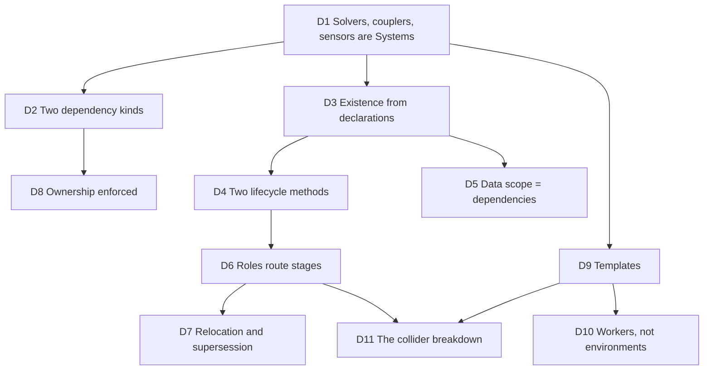

# Composable Pipeline: Design Decisions

The record of how the design of [PIPELINE.md](PIPELINE.md) was reached: each decision, the problem that forced it, what was rejected and why. It is for maintainers deciding whether a change fits the design, and for anyone wondering why the obvious alternative is not there.

Each entry reads: **Problem**, **Decision**, **Rejected**, **Consequences**.

---

## D1. Every solver, coupler and sensor is a System

**Problem.** Couplings were one `LegacyCoupler` class branching on which solvers were active, and the simulator branched on the coupler type. Removing a solver meant editing the coupler, the simulator and the other solvers.

**Decision.** Everything that runs in a step is a System, built-in or plugin, written the same way. The legacy coupler is split into one System per pair of coupled solvers (`RigidMPM`, `MPMSPH`, ...).

**Rejected.** A plugin API separate from the built-in solvers: two ways of writing the same thing, and the built-ins would never exercise the plugin path.

**Consequences.** Removing the rigid solver removes every rigid coupling, the collider, its components and the tactile sensors, with no other edit.

---

## D2. Two kinds of dependency: Data and System

**Problem.** Many components only read another one's state (the broadphase reads the geom poses), while some use another one's functions that change its state (a narrowphase runs GJK on GJK's scratch). Treating both alike hides which may run in parallel and lets a reader write.

**Decision.** A dependency typed with a Data struct is a read: read-only, enforced, a shared edge for scheduling. A dependency typed with a System is the use of its API: the API may write that System's state, an exclusive edge for scheduling.

**Rejected.** Every dependency on the System owning the Data: couples readers to their owner, serializes readers that could run side by side.

**Consequences.** Readers are decoupled from owners, and the read-only contract is checked at build (D8). It also breaks cycles: the broadphase reads the constraint state, which the constraint solver builds after the collider.

---

## D3. Existence comes from declarations alone

**Problem.** Systems decided whether to exist in a `create` classmethod (eight copies of `return cls(...) if options.flag else None`), and stages were gated by static flags computed by the collider (`has_terrain`, `has_nonconvex_nonterrain`).

**Decision.** A System exists when every mandatory dependency exists and every `Enabled` condition on its options holds. Two moments decide it: before any build (options, scene content), and after an owner builds (the Data it produced, such as a pair family).

**Rejected.**
- `create`: an extra lifecycle method whose only job was a veto.
- Inert Systems that exist but skip their work when their input is empty: a guard to remember in every stage, Systems that do nothing listed in the scene, components allocated for them.
- A table in the simulator mapping options to Systems: placement of the knowledge far from the System it concerns.

**Consequences.** A stage depends on the pair family it processes and exists exactly when it has work. `enable_collision=False` removes the collider and everything below it, where it used to only skip the detection.

---

## D4. Two lifecycle methods: `__init__` and `build`

**Problem.** The lifecycle had grown to `create`, `__init__`, `setup`, `build`, `compose`: one veto, two places to declare dependencies, two to allocate and wire.

**Decision.** `__init__(dependencies)` receives every dependency and says what it will use of them; `build()` allocates what the scene sizes. A System is created once its System dependencies exist and its Data dependencies are built, so `__init__` can receive everything.

**Rejected.**
- `setup`: needed only for Systems created before the pipeline (the sensor manager), which the pipeline now creates.
- `compose`: where stages go is static (D6), so nothing needs wiring at build.

**Consequences.** The ordering rules live in the pipeline: creation as soon as decidable, build once every possible API user is created or ruled out (so every `reserve` is in), a Data dependency never delaying its owner. A contradiction is raised with its cycle named.

---

## D5. The scope of Data is the dependency graph

**Problem.** Shared Data (the SDF of the rigid solver, read by sensors and couplings) was found through a global namespace of the scene, and opted in through it before the owner built. Several instances of one struct (one SDF for rigid, one for deformable) needed namespaces nested by hand.

**Decision.** A System reaches the Data of the Systems it depends on, and nothing else. Two instances are distinct because their users depend on distinct Systems.

**Rejected.** Namespaces and their nesting: a second scoping mechanism duplicating the dependency graph. `attach()` (adding a field to a struct owned elsewhere) and `opt_in(cond=...)` (deferring an opt-in until the owner builds) are made redundant by by-name binding, extension points (`Inline`) and late creation.

**Consequences.** Depending on a component is what makes it exist (D3, on demand), which replaces the opt-in of whole structs.

---

## D6. Roles route stages; stages are not wired by hand

**Problem.** Systems added their stages to other Systems' phases in code (`step.couplings.add(...)`), placement being static information executed at build. A per-kernel `@stage(slot)` decorator would scatter the same information over every kernel.

**Decision.** The System offering a phase defines its slots and the roles filling them. A participant subclasses a role and provides its entry point; the owner routes every existing participant. Order within a slot is registration order, never build order.

**Rejected.**
- Per-kernel stage decorators: placement is a property of the role, not of each kernel.
- Free ordering constraints (`before=`/`after=` everywhere): flexible, but the dense contracts of a component like the collider (pairs in, contacts out) would no longer be stated anywhere.
- Order by build timing: changing a dependency would silently reorder stages and change results.

**Consequences.** A System with several stages plays several roles, each with a distinctly named entry point. Positions nobody foresaw go through D7.

---

## D7. Relocation and supersession

**Problem.** IPC simulates the rigid entities it couples before the rigid solver runs, moving the rigid substep after the couplings. SAP solves the rigid constraints itself, between the rigid dynamics and integration. Both were branches inside the rigid solver reading coupler properties.

**Decision.** A System declares statically the roles of other Systems it moves (`relocations`) and the Systems it replaces (`supersedes`). They take effect only while the declaring System exists. Two existing Systems relocating the same role is refused.

**Rejected.** Validating that a relocation is physically correct: impossible in general. It is the plugin author's responsibility, and a user disables the System declaring a relocation that breaks a scene. Importing a plugin never rearranges anything by itself.

**Consequences.** The rigid solver holds no coupler-specific code. IPC's condition (some rigid entity coupled by IPC) becomes the existence of a separate `IPCRigidCoupling`.

---

## D8. Ownership is enforced, not documented

**Problem.** Nothing stopped a stage from writing another System's state, which breaks both reasoning and any future parallel scheduling.

**Decision.** A System's Data is written by its own stages and by its declared API (`@GJK.api`) alone; Data depended on as Data is read-only. Both are checked at build by the write analysis of kernels (`genesis/grad/kernel_writes.py`), the API funcs being opaque to it.

**Rejected.** Convention only: the guarantees are the precondition of automatic scheduling, so they must hold by construction.

**Consequences.** Python stages stay unchecked, being the System's own code.

---

## D9. Templates for families of Systems

**Problem.** One GJK packed three scratch states, opted in by its users, so every user saw every mode and the scheduler saw one shared state.

**Decision.** A template (`class GJK[LayoutT: Layout, CapabilityT: Capability](System)`, Python 3.12 syntax) is a family of Systems sharing code, each argument tuple a distinct class with its own state and its own identity as a dependency, created on demand. Parameters are the independent meaningful axes and every combination is supported, used or not. A dependency can be conditioned on the dependent's arguments (`type IfQueued[T] = Annotated[T | None, OnlyIf(Queued)]`).

**Rejected.**
- Keyword parameters (`GJK.of(epa=True)`): readable but rejected by type checkers in annotations.
- Sizes as parameters: a size is a runtime value, set by the users of an instance.
- Python 3.10-compatible `Generic`/`TypeVar` declarations: every parameter declared twice.

**Consequences.** Instances coexist and share nothing, so users of distinct modes can run in parallel.

---

## D10. Scratch indexed by workers, not by environments

**Problem.** The queued narrowphase passes sized the GJK and MPR scratch by passing a worker count under the name `envs`, abusing the environment dimension.

**Decision.** Scratch states are declared over a `WORKERS` dimension. The `PerEnv` layout sizes itself with one worker per environment; the `Queued` layout is sized by its users through `reserve`, to the largest request.

**Consequences.** MPR is a template over the layout alone, its per-environment and queued instances coexisting (the monolithic convex narrowphase and convex vs terrain). GJK is a template over layout and capability.

---

## D11. The collider breakdown

**Problem.** One detection kernel gated every narrowphase by static flags, and every component (GJK, MPR, SDF, support field) was reached through `collider_info`, so the couplings and sensors depended on the collider to read the SDF.

**Decision.** The collider offers the `detection` phase with the slots `broadphase`, `narrowphase`, `pruning`. The narrowphases are Systems per pair family: convex vs convex (a template over the layout), primitive vs primitive, convex vs terrain, convex vs non-convex (present, not enabled), non-convex vs non-convex. Non-convex vs terrain has no System and keeps raising. Components are Systems on demand, their API funcs taking their own Data.

**Rejected.** A breakdown by algorithm module (MPR, GJK, SDF as stages): they are tools several stages share, not stages.

**Consequences.** The fused detection launches one kernel as before. Records saved before the change name the collider arrays under `RigidSolver.collider`, and do not load after it.

---

## Open points

| Point | Status |
|---|---|
| The rigid solver's roles under IPC and SAP | to implement through D7 |
| `requires()` and field-level `opt_in` of the Data declarations | expected redundant after D11, to confirm on the code |
| Python 3.12 floor | assumed; the repository bump lands separately |
| Ordered slots | designed in D6, to implement with the collider |
